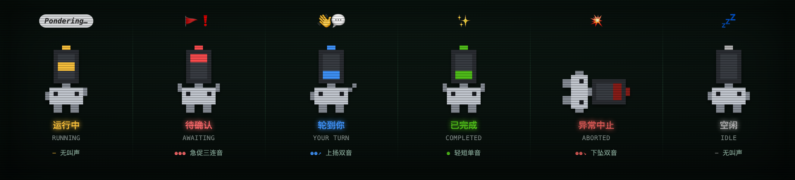

<p align="center">
  
</p>

<p align="center">
  <em>A desktop pet for every Claude Code, Codex CLI, or Antigravity CLI session — so you always know which one needs you.</em>
</p>

<p align="center">
  
  
  
</p>

## 这是什么

同时开着好几个 Claude Code / Codex CLI / Antigravity CLI 会话，一旦切到别的窗口，就再也感知不到哪个在等你确认、哪个已经跑完、哪个挂了。

**red-green** 把每个本机会话变成一只常驻桌面、置顶于所有窗口的**像素宠物**，用**行为动画**告诉你会话此刻的**状态**——敲键盘 = 运行中，举牌跳 = 待确认，探头张望 = 轮到你，比耶 = 已完成，躺平 = 异常中止，睡觉 = 空闲。

- **一会话一宠物**，脚下**名牌**写着项目名；**皮肤**按项目名哈希分配（灯灯🚦 / 钳钳🦀 / 灰灰🐱），同一项目永远同一只——看形象就知是哪个项目。
- **点宠物**直接切到会话所在的终端标签页（Apple Terminal 与 Ghostty 1.3+，tmux 也认）。
- 需要拉回注意力的状态还会**叫**：音色随皮肤（听声辨项目），节奏随状态（听节奏辨事件）；你正看着的那个会话不出声（**前台静默**）。
- 宠物列顶上有一枚**用量表**：按来源显示账号用量，点击切换 Codex / Antigravity / Claude 及额度组，默认优先显示 Codex。外圈和圆心是首窗口，内圈是第二窗口，灯色从绿到红；悬停展开实际窗口时长与重置时刻。Codex 与 Antigravity 数据缺失或过期显示未知。用量耗尽前就能看到，不用回终端敲 `/usage`。
- 整列沿屏幕右缘**从上往下**排，起点避开聊天窗口贴顶时的工具栏，下部留给发送按钮之类的东西；宠物和用量表都可拖动。
- **ESP-Mosaico** 可以通过 USB-C 接管宠物、叫声和用量表，拔线后自动回到 Mac。[在 CoreBoard V1.2.1 上使用](#在-esp-mosaico-上显示宠物和用量)
- **Supernote Nomad** 与 **Kindle Paperwhite** 可以在同一 Wi-Fi 上查看当前会话、跟随新消息，并在 Mac 授权后回复 Codex。[在 Nomad 上查看和回复会话](#在-supernote-nomad-上查看和回复会话)

## 状态图鉴

<p align="center">
  
</p>

六个**会话状态**由 Claude Code hook、Codex App Server 或 Antigravity CLI statusLine / hooks 判定，驱动宠物的姿态、气泡与叫声。完整定义——含「轮到你」的问句启发式、「已阅」规则（聚焦终端即视为看到，但看到问题不等于回答了它）、前台静默——见 [CONTEXT.md](CONTEXT.md)。

## 安装与运行

```sh
./install.sh                       # Claude Code：装 hooks 与 status line
./scripts/install-codex.sh         # Codex CLI：一次性配置原生标题（可只装所需来源）
./scripts/install-antigravity.sh   # Antigravity CLI：一次性配置 statusLine 与极简 hooks
cd app && pnpm install             # 2. 前端依赖（仅 @tauri-apps/cli）
../scripts/install-app.sh          # 3. 构建 .app 装进 ~/Applications 并注册登录自启
```

常驻版正常或异常退出后都会自动重启。需要停用时执行 `launchctl unload ~/Library/LaunchAgents/dev.y9g.red-green.plist`，恢复用 `launchctl load ~/Library/LaunchAgents/dev.y9g.red-green.plist`。开发迭代用 `pnpm tauri dev`，先按上述方式停用常驻版。

首次运行时 macOS 会请求「自动化」权限（控制 System Events，以及 Terminal / Ghostty）——点击聚焦与已阅检测靠它；`.app` 是独立应用身份，会各弹一次。

### Codex CLI

安装后直接运行 `codex`，无需 `red-green-codex` 包装命令。安装脚本将 `thread-id` 加到 `tui.terminal_title` 首位，其余标题项、设置、注释保留，原配置旁生成 `.red-green-时间戳.bak` 备份。重复安装无重复项。安装时尊重 `CODEX_HOME`，并将目录登记到 `~/.config/red-green/codex-home`，使登录自启的 app 也能找到它。修改后重启 red-green，并新开 Codex 会话。手动配置亦可：

```toml
[tui]
terminal_title = ["thread-id", "activity", "thread-name", "project-name"]
```

已验证 **Codex CLI 0.162.1、本机默认共享 App Server**。标题会显示会话 ID（0.162.1 标题缩为 29 字符加省略号），用它准确区分同目录多会话；请保留该项并允许终端更新标题。Terminal、Ghostty 1.3+ 和 tmux 沿用原有聚焦通路。首次运行允许 macOS 自动化权限。

限制：`--no-daemon`、强制使用内嵌服务的 `-c` 配置、远程 App Server、多个不同 `CODEX_HOME` 同时运行，以及其他终端不在本版支持范围。使用自定义配置时优先写入 `config.toml`。同一 thread 同时在多个 CLI 打开只算一个会话，选择 tty 排序的第一个。桌面宠物只观察当前终端中仍存活的 CLI。已退出终端的 Codex 对话可在 Nomad 的「历史会话」中查看。每 1.5 秒采样，短于间隔的状态可能看不到；问句判断是启发式。Codex 升级若改变实验性回合接口，需重新验证兼容性。

账号用量每 60 秒读取一次，不按宠物累计。按账号与额度组区分，API 计费或读取不到限额时显示未知；超过重置时刻或成功快照超过 120 秒也显示未知，悬停提示含最后更新时间。只展示有对应来源宠物的用量。桌面观察器只读取状态和用量，审批由终端处理。

可运行 `app/src-tauri/target/debug/red-green --check-codex` 做只读诊断（输出已绑定会话、状态和额度组数，不输出答复或凭据）。宠物没出现时先检查 `codex --version`、标题中的会话 ID（0.162.1 标题缩为 29 字符加省略号）、`$CODEX_HOME/app-server-control/app-server-control.sock`（默认 `~/.codex`）以及自动化权限。标题为空、进程已退出、会话未在服务中加载或连接失败时不会猜测会话归属。配置文件是符号链接时安装脚本会停止，请手动配置标题。恢复安装前设置可使用备份，或只移除标题中的 `thread-id`；再删除 `~/.config/red-green/codex-home` 即可解除目录登记。

如果重新设置过 Codex 标题，请确认仍保留 `thread-id`；可再次运行安装脚本补回，其他标题项会保留。配置文件修改不会刷新已打开会话的旧标题：在各会话中通过 `/title` 启用 Thread ID 并保存，或在方便时重新打开会话。用 `launchctl list dev.y9g.red-green` 检查常驻进程是否有 PID；已加载但没有运行时，可用 `launchctl kickstart gui/$(id -u)/dev.y9g.red-green` 恢复。

### Antigravity CLI

运行 `./scripts/install-antigravity.sh` 即可完成一次性配置，日常继续直接运行 `agy`，无需包装命令。脚本会链接 `~/.gemini/antigravity-cli/red-green-status.sh`，并在备份原文件后幂等合并两处配置（符号链接或非法 JSON 时直接中止不覆盖）：

1. `~/.gemini/antigravity-cli/settings.json`：优先写入零输出 `statusLine`（`stack_with_default: true`，保留内置底栏）；若你已有自定义 `statusLine`，自动改用零输出 `title` 槽位；若两者均已自定义，则保留原配置并提示在自定义脚本里把 stdin JSON 同步管道给 `~/.gemini/antigravity-cli/red-green-status.sh statusline`。
2. `~/.gemini/config/hooks.json`：写入独立的 `"red-green"` 条目，仅订阅 `Stop` 与 `ask_question` 的 `PreToolUse` / `PostToolUse`，并按 `/.gemini/antigravity-cli/` 路径过滤，不影响 Antigravity App、Antigravity IDE 及其他工具调用。

已验证 **Antigravity CLI (`agy`) 1.5.18**。终端聚焦、已阅与前台静默沿用 Apple Terminal、Ghostty 1.3+ 与 tmux 通路；宠物按项目分配皮肤，会话退出或关窗后 1.5 秒内自动离场。账号用量随 `statusLine` 自动采集，按模型组（如 `Gemini`、`Claude / GPT`）展示五小时与七天窗口，同账号多会话不重复计入；未使用过的窗口显示真实 `0%`，缺失、非法或已过期的窗口显示未知（`?`），不伪装为零用量。开启局域网会话共享后，Antigravity CLI 会话会出现在 Supernote Nomad 与第 10 代 Kindle Paperwhite 的当前会话列表，打开即可阅读并跟随更新。

限制：仅支持本机交互式 `agy` 会话，`agy -p` 非交互模式、`agy acp` 编辑器后端、Antigravity App 与 IDE 不在支持范围；`statusLine` 受 CLI 300ms 节流，极短瞬时状态可能合并；若手动停用 `hooks.json` 里的 `red-green`，`ask_question` 弹窗不会触发待确认；电纸书首期仅支持当前可读会话阅读，不含 Nomad 历史浏览、远程回复与继续对话；ESP-Mosaico 已更新固件源码支持 `Antigravity` 来源展示，已刷旧版固件遇到含 Antigravity 会话的快照时会安全回退 Mac 桌面，重刷固件后即可在设备显示。恢复安装前配置可使用自动生成的 `.red-green-时间戳.bak` 备份，或移除 `settings.json` 中的对应槽位、`hooks.json` 中的 `"red-green"` 条目并删除 `~/.gemini/antigravity-cli/red-green-status.sh`。

### Kindle 与 Nomad 首次配对

1. 让 Mac 和阅读设备连接可互访的可信 Wi-Fi。在 Mac 菜单栏点「钳钳」图标，选择「开启局域网会话共享」，再打开菜单查看地址和六位码。
2. 在 Nomad 笔记中插入「网页」链接，填入完整的 `http://` 地址。Kindle 用内置浏览器打开同一地址，点「Kindle 阅读」，也可以直接收藏 `/kindle`。在第一台设备上输入配对码。
3. 添加第二台时，在 Mac 菜单点「点此换码」，把新码输入第二台设备。每个码十分钟内可用一次。此后两台设备均可从自己的书签进入，切换时无须换码。升级前已经配对的浏览器可继续使用。

要在设备上回复 Codex，请在两台都配对后选择「允许所有已配对设备回复 Codex」。换码或重启共享会关闭回复权限。关闭共享会保留配对记录，「解除所有设备配对」会让所有浏览器退出。某台浏览器清除了配对 Cookie 或 Cookie 到期（30 天）时，只需为该浏览器重新配对。

### 在 Supernote Nomad 上查看和回复会话

**选择会话**

- **首页**的浏览器标题是「red-green · 当前会话」。卡片显示项目、来源、状态和会话名。首次进入首页时，若只有一条可读会话，就会直接打开它。已有 Claude Code 与 Antigravity CLI 会话在收到对话记录路径后出现，Codex CLI 会话通过本机 App Server 与终端绑定。
- **历史会话**在首页右上角，浏览器标题是「red-green · 历史会话」。这里列出这台 Mac 上当前账号的未归档 Codex CLI 对话，包括终端中仍打开的会话。列表按最近更新排序，每条显示会话名、项目和更新时间，可按项目名筛选。项目取自会话工作目录，在 Git 仓库内显示仓库名。历史功能需要支持当前账号筛选的本机 App Server（Codex CLI 0.171.0 起）。点右上角的「返回首页」可回到当前会话列表。

**阅读与自动刷新**　详情有独立网址，刷新后仍在同一会话。正文从屏幕顶部开始，Markdown 标题、列表、引用、表格和代码块按网页排版。浏览器标题按「来源 · 状态 · 项目名 · 会话名」排列，例如「Codex CLI · 待确认 · red-green · 调整分页」。项目和会话同名时合并显示。Codex 会话没有名称时取预览首个非空行，两者都为空时显示「未命名会话」。

详情在前台约每 3 秒检查一次更新。即使没有新消息，Nomad 原生标题栏也会自动显示最新的会话状态。页面会保留阅读位置、草稿和输入焦点。从历史入口回看已激活的会话也会同步状态，尚未激活的历史会话显示「只读」。[Nomad 真机验收记录 #33](https://github.com/yangzhyo/red-green/issues/33)

打开详情时从最新一轮的开头读起，同轮的提问、补充和回复在同一页。轻点正文右半屏向下读一屏，左半屏向上读一屏，相邻两屏重叠约一行，到本轮首尾即停。向左滑进入下一轮，向右滑返回上一轮，底部的「上一屏」「下一屏」也能切换轮次。宽表格可在表格内横向拖动。在最新一轮末尾会自动跟随更新，回看时保留当前段落，点「有新消息」可跳到最新正文末尾。断网后重新连接，只要会话仍可读就会补齐消息。底部的「返回列表」回到首页，「返回历史」回到先前的筛选和位置。从笔记链接进入时，浏览器的后退键可直接回到笔记。

**回复或继续 Codex 对话**　在 Mac 菜单选择「允许所有已配对设备回复 Codex」。从首页或历史进入已激活的会话，都可点底部的「回复」，在页面顶部输入并发送。审批在 Mac 终端处理。如果断网导致发送结果未知，先核对正文再发送。两端同时发送时，Codex 可能把两条输入合入同一回合。

已退出终端的对话可以直接回看。要继续时，点「继续对话」，Mac 会在原工作目录恢复同一会话，并在连接后展开 Nomad 的输入框。Mac 已运行 Ghostty 时优先新开标签，也支持系统「终端」的新窗口。若原目录已移动或删除，已有记录仍可阅读。若提示在 Mac 上查看终端，先处理新窗口内的提示。确认窗口未打开或已关闭后，可在 Mac 关闭再开启共享，重新允许回复后再试。

升级并重启 Mac 应用后，重新开启局域网共享，再刷新设备上已打开的详情页。切换 Wi-Fi 后，若 Mac 菜单显示的地址有变化，请更新笔记链接或书签。

### 在 Kindle Paperwhite（第 10 代）上阅读会话

从书签打开 `/kindle` 后，列表显示当前会话的标题、项目和来源。点标题即可阅读。

打开会话后从最新一轮的开头读起。每轮提问及其回复放在同一页，长文、表格和代码可上下滚动阅读。轻点正文左半屏向上读一屏，右半屏向下读一屏，两屏间保留约一行。点到页首或页末会停住。在正文上向左滑进入下一轮，向右滑回到上一轮，也可以点底部的「上一屏」「下一屏」切换轮次。固定底栏左侧显示当前会话状态，例如「运行中」或「待确认」。在前台阅读时约每 3 秒检查一次，回看旧轮次时状态也会更新，阅读位置会保留。关闭脚本时可手动刷新查看状态。底栏右侧显示「查看最新」「返回列表」「上一屏」「下一屏」，到达首轮或末轮时，相应方向显示为灰色。停在末尾会跟随新内容，回看时点「有新消息」可跳到最新。关闭脚本后仍可用底部链接阅读和手动更新。

**在 Kindle 回复 Codex**　在 Mac 菜单栏选择「允许所有已配对设备回复 Codex」。打开当前 Codex 会话，点底部「上一屏」前的「回复」，输入文字后点「发送」，页面会回到最新正文。关闭脚本时，授权后刷新正文即可看到入口。回合进行中要等它结束，审批提示在 Mac 终端处理。如果发送结果待核对，先查看最新正文。Claude 会话可继续阅读。

### 在 ESP-Mosaico 上显示宠物和用量

已在 CoreBoard V1.2.1 上通过真机验收。如果设备上已保存验收版，用 USB-C 数据线连接 Mac，在 Vibe 的「我的 IDEA」中选择 `red_green_6d208cf` 并点「运行」。连接就绪后，设备会接管宠物、叫声和用量表。拔线或健康检查失败时，Mac 自动接回。

480×480 屏幕左侧轮播主角，右侧每页显示五个会话。所有会话空闲 30 秒后熄屏，触摸屏幕或出现非空闲会话即可唤醒。设备沿用桌面的已阅和前台静默规则。首次安装前需核对实机分区并完整备份，保留 Vibe 与恢复区域。固件构建、安装步骤和验收记录见 [Mosaico 开发与验证](docs/mosaico.md)。

## 工作原理

```
hooks/session-status.sh              # Claude Code hook：把会话状态写进 ~/.claude/session-status/
hooks/antigravity.sh                 # Antigravity CLI statusLine / hooks 入口：写状态、用量与阅读映射
hooks/antigravity-state.mjs          # Antigravity CLI 状态机、额度组归一化与对话记录解析
statusline/usage.sh                  # Claude Code status line：把账号用量写进同一目录（hooks 拿不到用量）
scripts/install-codex.sh             # 一次性设置 Codex 原生标题，绑定本机终端会话
scripts/install-antigravity.sh       # 一次性配置 Antigravity CLI statusLine 与极简 hooks.json
scripts/merge-settings.mjs           # 把 Claude hook 与 status line 幂等合并进 ~/.claude/settings.json（先备份）
scripts/merge-antigravity-settings.mjs # 幂等合并 Antigravity CLI settings.json 与 hooks.json（先备份）
app/
  ui/          manager（隐藏的逻辑中枢）+ pet / gauge（哑渲染器）+ sprites/skins/calls/drag
  src-tauri/   Rust：文件 watcher + 命令（快照 / 用量 / 窗口 / 聚焦 / 前台 tty / 叫声）+ 光标轮询（用量表悬停）
```

Claude 链路：**hook 在回合边界写状态文件 → Rust watcher 感知变化 → manager 裁决皮肤 / 已阅 / 该不该叫 → 每只 pet 窗口哑渲染**。账号用量走旁路：status line 脚本写同目录的 `usage.json`，宠物列顶上的用量表显示一份（悬停展开明细）。Codex 由客户端标题绑定 tty，再通过本机服务只读接口获取状态与账号用量，合并到同一 manager。Antigravity CLI 由 `statusLine` 与极简 `hooks.json`（`Stop`、`ask_question`）写入同目录的状态、用量与阅读映射文件，Rust 侧校验 `agy` 进程存活后并入同一 manager 与局域网阅读服务。输入与 app 之间的契约见 [docs/protocol.md](docs/protocol.md)，关键架构决策见 [docs/adr/](docs/adr/)。

宠物形象与叫声都是预渲染、可重跑的：改皮肤看 `app/ui/sprites.js`，改叫声重跑 `scripts/gen-calls.mjs`，顶部这两张图重跑 `scripts/gen-readme-art.sh`。

## License

[MIT](LICENSE) © 2026 y9g
