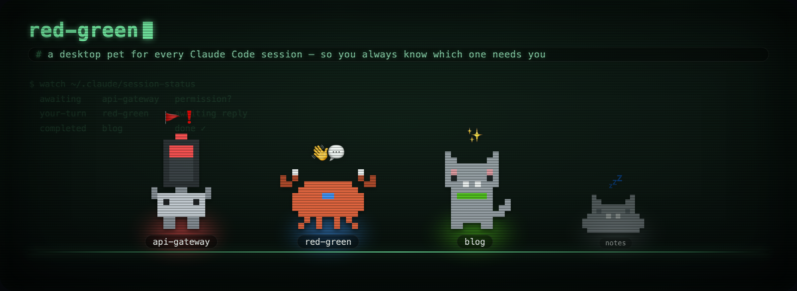
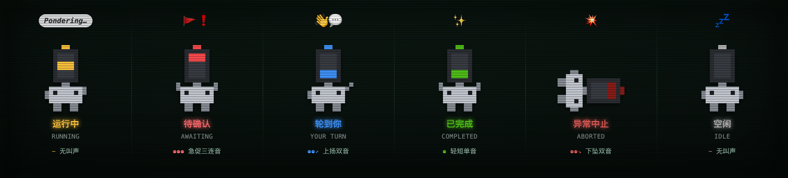

<p align="center">
  
</p>

<p align="center">
  <em>A desktop pet for every Claude Code or Codex CLI session — so you always know which one needs you.</em>
</p>

<p align="center">
  
  
  
</p>

## 这是什么

同时开着好几个 Claude Code / Codex CLI 会话，一旦切到别的窗口，就再也感知不到哪个在等你确认、哪个已经跑完、哪个挂了。

**red-green** 把每个本机会话变成一只常驻桌面、置顶于所有窗口的**像素宠物**，用**行为动画**告诉你会话此刻的**状态**——敲键盘 = 运行中，举牌跳 = 待确认，探头张望 = 轮到你，比耶 = 已完成，躺平 = 异常中止，睡觉 = 空闲。

- **一会话一宠物**，脚下**名牌**写着项目名；**皮肤**按项目名哈希分配（灯灯🚦 / 钳钳🦀 / 灰灰🐱），同一项目永远同一只——看形象就知是哪个项目。
- **点宠物**直接切到会话所在的终端标签页（Apple Terminal 与 Ghostty 1.3+，tmux 也认）。
- 需要拉回注意力的状态还会**叫**：音色随皮肤（听声辨项目），节奏随状态（听节奏辨事件）；你正看着的那个会话不出声（**前台静默**）。
- 宠物列顶上有一枚**用量表**：按来源显示账号用量，点击切换 Claude / Codex 及额度组，默认显示 Codex。外圈和圆心是首窗口，内圈是第二窗口，灯色从绿到红；悬停展开实际窗口时长与重置时刻。Codex 数据缺失或过期显示未知。用量耗尽前就能看到，不用回终端敲 `/usage`。
- 整列沿屏幕右缘**从上往下**排，起点避开聊天窗口贴顶时的工具栏，下部留给发送按钮之类的东西；宠物和用量表都可拖动。

## 状态图鉴

<p align="center">
  
</p>

六个**会话状态**由 Claude Code hook 或 Codex App Server 状态判定，驱动宠物的姿态、气泡与叫声。完整定义——含「轮到你」的问句启发式、「已阅」规则（聚焦终端即视为看到，但看到问题不等于回答了它）、前台静默——见 [CONTEXT.md](CONTEXT.md)。

## 安装与运行

```sh
./install.sh                 # Claude Code：装 hooks 与 status line
./scripts/install-codex.sh    # Codex CLI：一次性配置原生标题（可只装所需来源）
cd app && pnpm install       # 2. 前端依赖（仅 @tauri-apps/cli）
../scripts/install-app.sh    # 3. 构建 .app 装进 ~/Applications 并注册登录自启
```

开发迭代用 `pnpm tauri dev`（先退掉常驻版：`launchctl unload ~/Library/LaunchAgents/dev.y9g.red-green.plist`）。

首次运行时 macOS 会请求「自动化」权限（控制 System Events，以及 Terminal / Ghostty）——点击聚焦与已阅检测靠它；`.app` 是独立应用身份，会各弹一次。

### Codex CLI

安装后直接运行 `codex`，无需 `red-green-codex` 包装命令。安装脚本将 `thread-id` 加到 `tui.terminal_title` 首位，其余标题项、设置、注释保留，原配置旁生成 `.red-green-时间戳.bak` 备份。重复安装无重复项。安装时尊重 `CODEX_HOME`，并将目录登记到 `~/.config/red-green/codex-home`，使登录自启的 app 也能找到它。修改后重启 red-green，并新开 Codex 会话。手动配置亦可：

```toml
[tui]
terminal_title = ["thread-id", "activity", "thread-name", "project-name"]
```

已验证 **Codex CLI 0.162.1、本机默认共享 App Server**。标题会显示会话 ID（0.162.1 标题缩为 29 字符加省略号），用它准确区分同目录多会话；请保留该项并允许终端更新标题。Terminal、Ghostty 1.3+ 和 tmux 沿用原有聚焦通路。首次运行允许 macOS 自动化权限。

限制：`--no-daemon`、强制使用内嵌服务的 `-c` 配置、远程 App Server、多个不同 `CODEX_HOME` 同时运行，以及其他终端不在本版支持范围。使用自定义配置时优先写入 `config.toml`。同一 thread 同时在多个 CLI 打开只算一个会话，选择 tty 排序的第一个。只观察当前终端中仍存活的 CLI；不展示桌面端、历史会话或子代理。每 1.5 秒采样，短于间隔的状态可能看不到；问句判断是启发式。Codex 升级若改变实验性回合接口，需重新验证兼容性。

账号用量每 60 秒读取一次，不按宠物累计。按账号与额度组区分，API 计费或读取不到限额时显示未知；超过重置时刻或成功快照超过 120 秒也显示未知，悬停提示含最后更新时间。只展示有对应来源宠物的用量。不读取账号凭据，不接管审批，不修改用户会话。

可运行 `app/src-tauri/target/debug/red-green --check-codex` 做只读诊断（输出已绑定会话、状态和额度组数，不输出答复或凭据）。宠物没出现时先检查 `codex --version`、标题中的会话 ID（0.162.1 标题缩为 29 字符加省略号）、`$CODEX_HOME/app-server-control/app-server-control.sock`（默认 `~/.codex`）以及自动化权限。标题为空、进程已退出、会话未在服务中加载或连接失败时不会猜测会话归属。配置文件是符号链接时安装脚本会停止，请手动配置标题。恢复安装前设置可使用备份，或只移除标题中的 `thread-id`；再删除 `~/.config/red-green/codex-home` 即可解除目录登记。

## 工作原理

```
hooks/session-status.sh    # Claude Code hook：把会话状态写进 ~/.claude/session-status/
statusline/usage.sh        # Claude Code status line：把账号用量写进同一目录（hooks 拿不到用量）
scripts/install-codex.sh   # 一次性设置 Codex 原生标题；app 只读本机服务
scripts/merge-settings.mjs # 把 hook 与 status line 配置幂等合并进 ~/.claude/settings.json（先备份）
app/
  ui/          manager（隐藏的逻辑中枢）+ pet / gauge（哑渲染器）+ sprites/skins/calls/drag
  src-tauri/   Rust：文件 watcher + 命令（快照 / 用量 / 窗口 / 聚焦 / 前台 tty / 叫声）+ 光标轮询（用量表悬停）
```

Claude 链路：**hook 在回合边界写状态文件 → Rust watcher 感知变化 → manager 裁决皮肤 / 已阅 / 该不该叫 → 每只 pet 窗口哑渲染**。账号用量走旁路：status line 脚本写同目录的 usage.json，宠物列顶上的用量表显示一份（悬停展开明细）。Codex 由客户端标题绑定 tty，再通过本机服务只读接口获取状态与账号用量，合并到同一 manager。输入与 app 之间的契约见 [docs/protocol.md](docs/protocol.md)，关键架构决策见 [docs/adr/](docs/adr/)。

宠物形象与叫声都是预渲染、可重跑的：改皮肤看 `app/ui/sprites.js`，改叫声重跑 `scripts/gen-calls.mjs`，顶部这两张图重跑 `scripts/gen-readme-art.sh`。

## License

[MIT](LICENSE) © 2026 y9g
